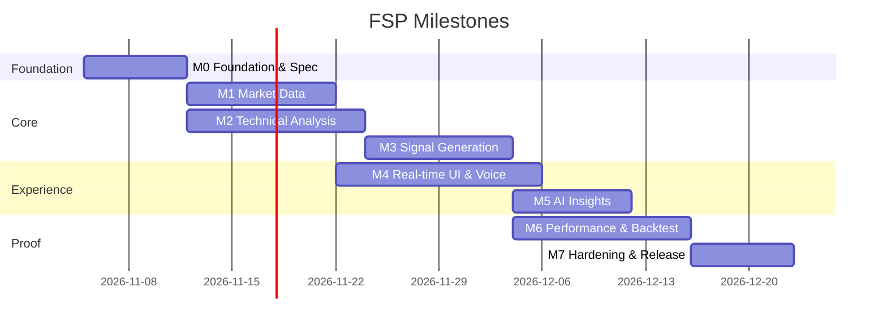

# Roadmap — Spec-Driven Delivery Plan

Her issue bir spec ID'sine (FR-xx / INV-xx / NFR) bağlıdır. Akış: **Spec → TLA+ (gerekirse) → Issue → Test (kırmızı) → Kod → TLC + test yeşil → PR (spec referanslı)**.

| Milestone | Çıktı | Çıkış kapısı |
|---|---|---|
| M0 Foundation | Repo, CI (build + TLC + ArchUnit), Modulith iskelet, design tokens | `./mvnw verify` + `scripts/tlc.sh` yeşil |
| M1 Market Data | Instrument kataloğu, TradingView scanner + OHLCV adapter, BarSeries, BarClock | INV-BAR-1/2 property testleri |
| M2 Technical Analysis | Artımlı gösterge motoru (40+), rejim sınıflandırıcı, golden testler | JMH: < 5 µs / gösterge / bar |
| M3 Signal Generation | Strategy, ConfluenceScorer, Signal/SignalBook aggregate, windows, cooldown | INV-SIG-1..4 property testleri |
| M4 Real-time UI & Voice | Dashboard, enstrüman detay, watchlist, SSE hub, sesli bildirim, PWA | LIV/INV-ALR Playwright testleri, LCP < 1.2 sn |
| M5 AI Insights | Açıklama, sentiment, NL sorgu, MCP server | Faithfulness eval ≥ 0.9 |
| M6 Performance & Backtest | Backtest, walk-forward, Monte Carlo, paper trading, performans paneli | §9 metrikleri raporlanır |
| M7 Hardening | Gatling yük testi, güvenlik, AOT/CDS, Docker, gözlemlenebilirlik | NFR §7.5 eşikleri |

Issue'lar: [`scripts/create-issues.sh`](../../scripts/create-issues.sh) ile GitHub'a aktarılır.
