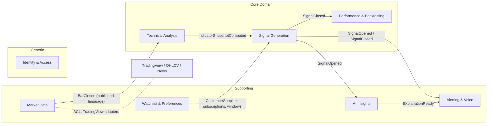
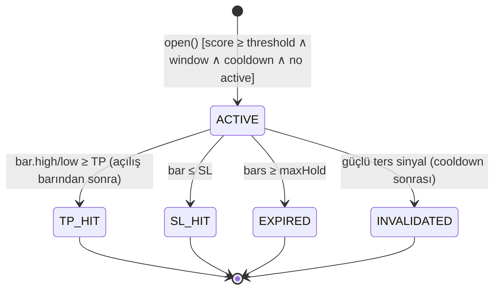
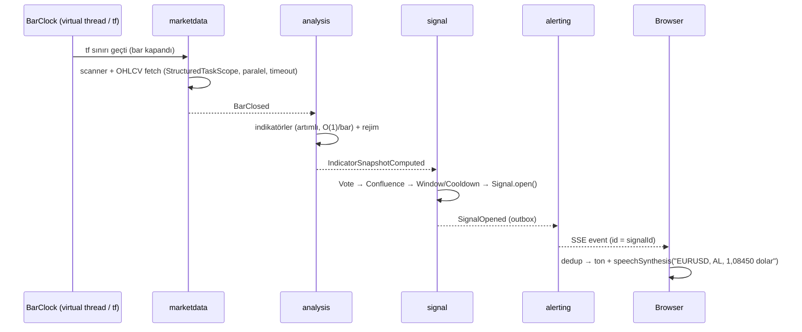

# SPEC-001 — Forex Signal Platform (FSP)

| Alan | Değer |
|---|---|
| Durum | **Approved** |
| Sürüm | 1.0.0 |
| Tarih | 2026-11-04 |
| Sahip | @aliturgutbozkurt |
| Yöntem | Spec-Driven Development (SDD) + TLA+ Planning-Driven Development |
| İlgili | [ADR dizini](../adr), [TLA+ modelleri](../tla), [Roadmap](../plan/ROADMAP.md) |

> [!CAUTION]
> **Yasal uyarı / dürüstlük ilkesi.** Bu sistem *karar destek* aracıdır, yatırım danışmanlığı değildir (SPK lisansı gerektiren faaliyet kapsamında sunulmaz). Hiçbir algoritma "yüksek kazanç oranı" veya "yüksek kâr" **garanti edemez**. Bu spec, kazanç hedeflerini *ölçülebilir, geriye dönük ve ileriye dönük (walk-forward / paper-trading) olarak doğrulanan* metrikler olarak tanımlar ve tüm metrikleri UI'da şeffaf gösterir (§9).

---

## 1. Vizyon

Forex, ABD hisseleri (NYSE/NASDAQ), Borsa İstanbul (BIST) hisseleri, emtialar ve endeksler için; kullanıcının seçtiği enstrüman ve zaman dilimlerinde, çoklu gösterge + hacim + piyasa rejimi + AI bağlamını birleştiren, **düşük gecikmeli**, **açıklanabilir** AL/SAT sinyalleri üreten ve bunları **ultra-premium** bir web arayüzünde, **AL ve SAT için farklı seslerle**, fiyatı birimiyle birlikte **sözlü olarak anlık** okuyan bir platform.

## 2. Kapsam

### 2.1 Kapsam içi
- Varlık sınıfları: `FOREX`, `US_EQUITY`, `BIST_EQUITY`, `COMMODITY`, `INDEX` (+ opsiyonel `CRYPTO` ileride).
- Zaman dilimleri: `M1, M5, M15, M30, H1, H2, H4, D1, W1, MN`.
- Kullanıcı tanımlı izleme listeleri, zaman dilimi seçimi, **sinyal üretim zaman pencereleri** (ör. "sadece BIST seansında 10:00–18:00", "Londra+NY overlap").
- Sinyal üretimi, yaşam döngüsü takibi (TP/SL/expire), performans istatistikleri.
- Gerçek zamanlı push (SSE), sesli bildirim (Web Speech API, tr-TR), görsel bildirim.
- AI: sinyal açıklaması (XAI), haber/sentiment bağlamı, doğal dilde sorgu ("THYAO için H4'te neden SAT?").
- Backtest + walk-forward + paper-trading ile strateji doğrulama.

### 2.2 Kapsam dışı (v1)
- Gerçek emir iletimi / broker entegrasyonu (otomatik işlem **yok**).
- Mobil native uygulama (PWA yeterli).
- Çok kiracılı SaaS faturalama.

## 3. Paydaşlar ve Kullanıcı Personaları
| Persona | İhtiyaç |
|---|---|
| **Aktif trader (scalper/day)** | M1–M15, <1 sn uyarı, sesli bildirim, tek ekranda çoklu sembol |
| **Swing trader** | H1–D1, güçlü confluence, düşük gürültü, AI gerekçe |
| **BIST yatırımcısı** | Seans saatleri, TRY birimi, Türkçe sesli okuma |
| **Analist** | Backtest, metrik şeffaflığı, strateji karşılaştırma |

## 4. Veri Kaynakları (ADR-0002)

| Kaynak | Rol | Notlar |
|---|---|---|
| **TradingView Scanner** (`scanner.tradingview.com/{market}/scan`) | Birincil: hazır göstergeler + `Recommend.All / .MA / .Other` | Resmî olmayan, ücretsiz; ToS gri alan → rate-limit, circuit breaker, cache, değiştirilebilir adapter. Market: `forex`, `america`, `turkey`, `cfd`, `futures` |
| **OHLCV adapter** (TradingView chart WS / Yahoo chart API) | İkincil: ham bar verisi → kendi gösterge motorumuz | Çift doğrulama + scanner'da olmayan göstergeler (VWAP, Ichimoku detay, Supertrend, OBV, CMF, MFI, ADX/DI, Volume Profile) |
| **Haber/sentiment** (RSS, KAP duyuruları, ekonomik takvim) | AI bağlamı | Opsiyonel, async |

> [!IMPORTANT]
> Tüm dış kaynaklar `MarketDataPort` / `IndicatorSnapshotPort` / `NewsPort` arkasındadır. Kaynak değişimi domain'i etkilemez (Hexagonal). Scanner kapanırsa sistem OHLCV + kendi motoruyla **degraded** modda çalışmaya devam eder.

## 5. Stratejik DDD

### 5.1 Ubiquitous Language (özet)
| Terim | Tanım |
|---|---|
| **Instrument** | İşlem gören varlık (sembol, borsa, varlık sınıfı, kote birimi, tick size, seans takvimi) |
| **Timeframe** | Bar periyodu |
| **Bar** | Kapanmış OHLCV mumu. *Oluşan bar* sinyal üretiminde **kullanılmaz** (no-repaint) |
| **IndicatorSnapshot** | Bir bar kapanışında hesaplanan gösterge değerleri kümesi |
| **Vote** | Bir göstergenin/kuralın −1..+1 aralığında yön oyu ve ağırlığı |
| **Confluence Score** | Ağırlıklı oyların rejime göre normalize toplamı, −100..+100 |
| **Market Regime** | `TRENDING_UP`, `TRENDING_DOWN`, `RANGING`, `VOLATILE` (ADX, ATR%, BB width) |
| **Signal** | Aggregate root: yön, giriş, SL, TP1/TP2/TP3, güven, gerekçe, durum |
| **Signal Window** | Kullanıcının sinyal üretilmesine izin verdiği zaman aralığı/seans |
| **Cooldown** | Aynı (enstrüman, timeframe) için iki sinyal arası min bar sayısı |
| **Strategy** | Vote üreticileri + ağırlıklar + eşikler + risk kuralları paketi |

### 5.2 Bounded Context Haritası



| Context | Tür | Modulith modülü | Entegrasyon |
|---|---|---|---|
| Market Data | Supporting | `marketdata` | ACL ile dış kaynaklar; `BarClosed` event yayınlar |
| Technical Analysis | Core | `analysis` | `BarClosed` dinler; `IndicatorSnapshotComputed` yayınlar |
| Signal Generation | **Core** | `signal` | Snapshot + rejim + tercih → `Signal` aggregate |
| Performance & Backtesting | Core | `performance` | `SignalClosed` dinler; metrik read-model |
| Watchlist & Preferences | Supporting | `watchlist` | Abonelikler, zaman pencereleri, ses tercihleri |
| Alerting & Voice | Supporting | `alerting` | SSE hub, ses/görsel bildirim payload'ı |
| AI Insights | Supporting | `ai` | Spring AI; açıklama, sentiment, NL sorgu |
| Identity & Access | Generic | `identity` | Spring Security, passkey (WebAuthn) + OAuth2 |

## 6. Taktiksel DDD (Rich Domain Model)

### 6.1 Aggregates
- **`Instrument`** (marketdata): `InstrumentId`, `Symbol`, `Exchange`, `AssetClass`, `Currency quote`, `TickSize`, `TradingSession` (TZ + açılış/kapanış + tatiller).
- **`BarSeries`** (marketdata): `(InstrumentId, Timeframe)` başına halka tampon; invariant: zaman damgaları kesin artan, boşluk yok (backfill), yalnızca kapanmış bar eklenir.
- **`Signal`** (signal) — *aggregate root*:
  - Değerler: `SignalId`, `InstrumentId`, `Timeframe`, `Direction{BUY,SELL}`, `Price entry`, `Price stopLoss`, `List<TakeProfit>`, `Confidence(0..100)`, `ConfluenceScore`, `MarketRegime`, `Rationale` (oy listesi), `SignalState`, `openedAtBar`.
  - Davranışlar: `open(...)` (factory, invariant kontrolleri), `onBarClosed(Bar)` → TP/SL/expire değerlendirme, `invalidateBy(Signal opposite)`, `explain(Explanation)`.
  - Invariantlar: BUY için `SL < entry < TP1 < TP2 < TP3`, SELL için tersi; `RiskReward(TP1) ≥ strategy.minRR`; durum makinesi §6.3.
- **`SignalBook`** (signal): `(InstrumentId, Timeframe)` başına tutarlılık sınırı → **INV-SIG-1/2** burada korunur.
- **`Strategy`** (signal): `StrategyId`, `List<VoteRule>`, `RegimeWeights`, `EntryThreshold`, `RiskPolicy` (ATR çarpanları), `Version`.
- **`Watchlist`** (watchlist): `UserId`, `Set<Subscription(InstrumentId, Set<Timeframe>)>`, `List<SignalWindow>`, `VoicePreference`.

### 6.2 Value Objects
`Price(BigDecimal amount, Currency)`, `Money`, `Percentage`, `Symbol`, `Timeframe`, `ConfluenceScore`, `Confidence`, `Vote(indicator, direction, strength, weight)`, `SignalWindow(DayOfWeek set, LocalTime from/to, ZoneId)`, `RiskReward`, `Atr`.
Tümü Java `record`, compact constructor'da doğrulama; ilkel tip saplantısı yok.

### 6.3 Signal Durum Makinesi (TLA+: `SignalLifecycle.tla`)



| ID | Invariant | Doğrulama |
|---|---|---|
| INV-SIG-1 | Anahtar başına ≤1 ACTIVE sinyal | TLC + jqwik property test |
| INV-SIG-2 | Ardışık sinyaller arası ≥ Cooldown bar | TLC + property test |
| INV-SIG-3 | Terminal durumlar emici | TLC + `Signal` unit test |
| INV-SIG-4 | Açılış barında sonuçlanma yok | TLC + unit test |
| INV-BAR-1/2 | Yalnızca kapanmış bar; sıralı, boşluksuz, tek sefer | `BarIngestion.tla` |
| INV-ALR-1 | Her istemci her sinyali en fazla 1 kez seslendirir | `AlertDelivery.tla` |
| LIV-ALR-1 | Yayınlanan sinyal her bağlı istemciye eninde sonunda ulaşır | `AlertDelivery.tla` |

### 6.4 Domain Events
`BarClosed`, `IndicatorSnapshotComputed`, `MarketRegimeChanged`, `SignalOpened`, `SignalInvalidated`, `TakeProfitHit`, `StopLossHit`, `SignalExpired`, `SignalExplained`, `WatchlistChanged`. Hepsi `@DomainEvent` (jMolecules) + Modulith `@Externalized` adayları; Event Publication Registry (JDBC) ile transactional outbox.

## 7. Mimari

### 7.1 Teknoloji Yığını (Kasım 2026)
| Katman | Seçim |
|---|---|
| Dil / Runtime | **Java 25 (LTS)**, virtual threads, structured concurrency, scoped values, records/sealed/pattern matching, compact object headers (JEP 519), AOT cache (JEP 514/515) |
| Framework | **Spring Boot 4.1.x**, **Spring Modulith 2.1.x**, Spring Framework 7 (JSpecify null-safety, API versioning) |
| Mimari doğrulama | Modulith `ApplicationModules.verify()`, **jMolecules** (DDD + Hexagonal annotasyonları) + ArchUnit |
| UI | **Thymeleaf 3.1** + **HTMX 2** + SSE extension + Alpine.js; Vanilla CSS design system (OKLCH, container queries, View Transitions API); TradingView **Lightweight Charts** (açık kaynak) |
| Ses | Web Speech API (`speechSynthesis`, tr-TR / en-US), Web Audio API ile AL/SAT farklı tonlar |
| AI | **Spring AI 2.0.x** — varsayılan Google Gemini, lokal fallback Ollama; structured output, tool calling, MCP server (sinyal sorgu araçları) |
| Persistans | PostgreSQL 18 + TimescaleDB (bar & snapshot hypertables), Flyway; Redis/Valkey (hot cache, rate-limit) |
| Mesajlaşma | Modulith in-process events + JDBC Event Publication Registry; ileride Kafka externalization |
| Gözlemlenebilirlik | Micrometer + OpenTelemetry (traces/metrics/logs), Modulith observability, Grafana |
| Dayanıklılık | Resilience4j (circuit breaker, rate limiter, bulkhead, retry w/ jitter) |
| Test | JUnit 6, AssertJ, jqwik (property), Testcontainers, Modulith `@ApplicationModuleTest` + `Scenario`, Playwright (E2E), JMH (mikro benchmark) |
| Build / Dağıtım | Maven 4 wrapper, CDS/AOT cache, Docker (distroless), opsiyonel GraalVM native profile |
| Güvenlik | Passkeys (WebAuthn) + OAuth2 login, CSP strict, CSRF, OWASP dependency-check, SBOM (CycloneDX) |

### 7.2 Hexagonal Modül Yapısı
```
com.fsp
├── FspApplication
├── shared            (shared kernel: Price, Currency, Timeframe, Symbol – @SharedKernel)
├── marketdata
│   ├── domain        (Instrument, BarSeries, Bar, TradingSession)
│   ├── application   (use cases, ports.in / ports.out)
│   └── adapter
│       ├── in        (scheduler, REST admin)
│       └── out       (tradingview.scanner, ohlcv.yahoo, persistence.timescale)
├── analysis          (IndicatorEngine, RegimeClassifier — saf Java, framework'süz)
├── signal            (Signal, SignalBook, Strategy, ConfluenceScorer)
├── performance
├── watchlist
├── alerting          (SseHub, VoicePayloadFactory)
├── ai                (ExplanationService, SentimentService, McpTools)
├── identity
└── web               (Thymeleaf controllers, view models, HTMX fragments)
```
Kurallar: `domain` paketleri Spring'e bağımlı **olamaz**; modüller arası yalnızca `api`/event ile iletişim; döngüsel bağımlılık yok (ArchUnit + Modulith verify CI'da kırmızı).

### 7.3 Sinyal Üretim Hattı


### 7.4 Göstergeler ve Oylama (Vote Rules)
| Grup | Göstergeler |
|---|---|
| Trend | EMA 9/21/50/200, SMA, HMA, Ichimoku (Tenkan/Kijun/Kumo), Supertrend, Parabolic SAR, ADX/+DI/−DI |
| Momentum | RSI(14), Stoch(14,3,3), StochRSI, MACD(12,26,9), CCI(20), Williams %R, Momentum, Awesome Osc., Ultimate Osc. |
| Volatilite | ATR(14), Bollinger(20,2), Keltner, Donchian, BB width / squeeze |
| Hacim | Volume vs SMA(20) (relative volume), OBV, VWAP (+bands), CMF, MFI, A/D, Volume Profile (POC/VAH/VAL) |
| Yapı | Pivot (Classic/Fibonacci/Camarilla), destek/direnç, swing high/low, divergence (RSI/MACD) |
| TradingView | `Recommend.All`, `Recommend.MA`, `Recommend.Other` (dış oy, ağırlık ayarlanabilir) |
| Çoklu TF | Üst zaman dilimi trend filtresi (MTF confirmation) |

**Skorlama:** `score = Σ(w_i(regime) · vote_i) / Σ w_i × 100`. Giriş: `|score| ≥ threshold(regime)` ∧ hacim teyidi (RVOL ≥ 1.2) ∧ MTF uyumu ∧ window ∧ cooldown. SL/TP: ATR tabanlı (SL = 1.5·ATR, TP1/2/3 = 1.5R/2.5R/4R), yapı seviyelerine yapıştırma.

### 7.5 Performans / Düşük Gecikme Bütçesi
| NFR | Hedef (p99) |
|---|---|
| Bar kapanışı → `SignalOpened` (sunucu içi) | **< 50 ms** / enstrüman |
| `SignalOpened` → tarayıcıda ses başlangıcı | **< 300 ms** (LAN), < 800 ms (internet) |
| 500 enstrüman × 3 TF tarama döngüsü | < 2 sn (scanner toplu istek + paralel virtual threads) |
| Gösterge güncellemesi | Artımlı (incremental) O(1) / bar, allocation-free hot path (JMH ile doğrulanır) |
| Sayfa ilk yüklemesi | LCP < 1.2 sn, INP < 100 ms, CLS < 0.05 |
| Başlangıç süresi | < 1.5 sn (AOT cache) |

Teknikler: scanner'a sembol başına değil **toplu (batch) istek**, HTTP/2 keep-alive, `ScopedValue` ile istek bağlamı, primitive dizili ring buffer, `StructuredTaskScope` ile fan-out + deadline, Valkey'de son snapshot cache, SSE ile minimal JSON payload, HTMX OOB swap.

## 8. Fonksiyonel Gereksinimler

| ID | Gereksinim | Kabul Kriteri (Given/When/Then özet) |
|---|---|---|
| FR-01 | Enstrüman kataloğu (Forex, US, BIST, emtia, endeks) arama/filtre | "THY" yazınca <100 ms'de THYAO (BIST, TRY) listelenir |
| FR-02 | İzleme listesi CRUD + enstrüman başına çoklu timeframe | Kaydet → `WatchlistChanged` → tarama planı güncellenir |
| FR-03 | Sinyal zaman pencereleri (seans/gün/saat, TZ) | Pencere dışında `Signal.open()` reddedilir (domain exception, log) |
| FR-04 | Göstergelerden confluence skoru üretimi | Snapshot fixture → deterministik skor (golden test) |
| FR-05 | AL/SAT sinyali: giriş, SL, TP1-3, güven, R:R, rejim, gerekçe | Invariant ihlalinde sinyal oluşmaz |
| FR-06 | Sinyal yaşam döngüsü (TP/SL/expire/invalidate) | INV-SIG-1..4 property testleri yeşil |
| FR-07 | Gerçek zamanlı SSE push + Last-Event-ID replay | Kopma sonrası kaçırılan sinyaller 1 kez gelir |
| FR-08 | **Sesli bildirim**: AL ve SAT için farklı ton + ses; "EURUSD, AL sinyali, fiyat 1,0845 dolar" / "THYAO, SAT, 312,50 lira" | Para birimi/birim adı locale'e göre okunur; ses tercihi (ses, hız, ton, sessiz saatler) |
| FR-09 | AI açıklaması (Türkçe, ≤ 3 cümle, oylara dayalı, halüsinasyon guard) | Açıklama yalnızca rationale'daki göstergelere atıf yapar (eval test) |
| FR-10 | Doğal dil sorgu ("Bugün BIST'te en güçlü AL sinyalleri?") | Tool-calling ile read-model sorgusu; kaynak gösterir |
| FR-11 | Performans paneli: win rate, profit factor, expectancy, max DD, Sharpe/Sortino, sinyal sayısı — strateji/varlık/TF bazlı | Değerler backtest motoruyla birebir |
| FR-12 | Backtest + walk-forward + Monte Carlo | Look-ahead bias testi (shift test) yeşil |
| FR-13 | Paper-trading modu (canlı sinyallerin sanal takibi) | Her `SignalClosed` sonrası equity eğrisi güncellenir |
| FR-14 | Grafik: TradingView Advanced Chart Widget + FSP Kapanmış Bar Grafiği, tüm 10 zaman dilimi (`M1, M5, M15, M30, H1, H2, H4, D1, W1, MN`) seçilebilir; her ekranda göstergelerin en üstünde toplam kaç `AL`, kaç `SAT`, kaç `TUT` olduğu + genel sentez kararı ve her göstergenin yanında `AL` / `SAT` / `TUT` rozeti gösterilir | 60 fps pan/zoom, tüm 10 zaman dilimi seçeneği aktif, üstte AL/SAT/TUT sayaç özeti ve her gösterge satırında AL/SAT/TUT kararı |
| FR-15 | Kimlik: passkey + OAuth2 (Google/GitHub) | Parolasız giriş |
| FR-16 | Strateji yapılandırma (ağırlık, eşik, risk) ve sürümleme | Değişiklik yeni `Strategy.version`, geçmiş sinyaller eski sürüme bağlı |
| FR-17 | Data source health & degraded mode göstergesi | Scanner circuit open → UI rozeti "Degraded" |
| FR-18 | i18n (tr, en) | Tüm UI + ses metinleri |

## 9. Kalite / Kazanç Hedefleri (ölçülebilir, garanti değil)

| Metrik | Hedef (walk-forward, son 24 ay, komisyon+spread dahil) | Yayın kapısı |
|---|---|---|
| Win rate (TP1) | ≥ %55 | Altındaysa strateji "experimental" etiketi |
| Profit factor | ≥ 1.5 | |
| Expectancy | > 0.25R / işlem | |
| Max drawdown | ≤ %15 (sabit %1 risk) | |
| Out-of-sample bozulma | IS→OOS PF düşüşü ≤ %30 | Overfitting koruması |
| Örneklem | ≥ 200 işlem / varlık sınıfı | İstatistiksel anlamlılık |

Önlemler: look-ahead bias yok (no-repaint TLA+ garantisi), survivorship bias (delist dahil), gerçekçi maliyet modeli, parametre optimizasyonunda walk-forward, AI'nın yön kararı **vermemesi** (yalnızca açıklama/bağlam; opsiyonel küçük ağırlıklı sentiment oyu, ablation testiyle).

## 10. UI/UX Gereksinimleri (Ultra Premium — Kurumsal Açık Tema)
- **Tasarım dili:** açık zemin öncelikli kurumsal finans arayüzü (AI klişesi mor/neon gradyanlar kullanılmaz; OKLCH açık palet: kırık beyaz/kağıt zemin `oklch(0.985 0.003 90)`, kart yüzeyi `#ffffff`, AL = kurumsal zümrüt `oklch(0.48 0.15 155)`, SAT = kurumsal mercan/kırmızı `oklch(0.52 0.19 25)`), net kenarlıklar, Inter / JetBrains Mono (rakamlar tabular-nums).
- **Ekranlar:** Dashboard (canlı sinyal akışı + heatmap), Enstrüman detay (grafik + gösterge paneli + AI açıklama), Watchlist & zaman pencereleri, Performans, Strateji laboratuvarı (backtest), Ayarlar (ses).
- **Etkileşim:** View Transitions, HTMX partial swap, skeleton loader, fiyat tick flash animasyonu, sinyal kartı "pulse", komut paleti (⌘K), klavye kısayolları.
- **Ses UX:** AL → yükselen iki tonlu çan + kadın/erkek seçilebilir ses; SAT → alçalan ton + farklı ses; sessiz saatler; tek tık "test sesi"; tarayıcı autoplay kuralı için ilk etkileşimde ses kilidi açma.
- **Erişilebilirlik:** WCAG 2.2 AA, `prefers-reduced-motion`, ARIA live region'da sinyal okuma.
- **PWA:** offline shell, Web Push (sekme kapalıyken bildirim).

## 11. Güvenlik & Uyum
OWASP ASVS L2, CSP nonce, rate limiting, secrets → env/Vault, KVKK uyumlu kişisel veri minimizasyonu, audit log (strateji değişiklikleri), LLM prompt-injection guard (haber metinleri sandbox).

## 12. Doğrulama Stratejisi (SDD + TLA+)
1. **Spec** (bu belge) → her FR/INV bir GitHub issue'ya bağlanır.
2. **TLA+** modelleri (`docs/tla`) CI'da TLC ile kontrol edilir; model ↔ kod eşlemesi `docs/tla/README.md`'de.
3. **Executable spec**: Kabul kriterleri JUnit/jqwik testlerine dönüşür (aynı ID'ler `@Tag("FR-06")`).
4. **Mimari fitness**: Modulith verify + ArchUnit + jMolecules.
5. **Performans fitness**: JMH + Gatling eşikleri CI'da.
6. Definition of Done: spec güncel, test yeşil, TLC yeşil, ADR (gerekirse), dokümantasyon (Modulith `Documenter`).

## 13. Karara Bağlanan Açık Sorular (Sign-off)
- **Q1 (Veri sağlayıcı ToS):** `IndicatorSnapshotPort` ve `MarketDataPort` Hexagonal port olarak soyutlandı (ADR-0002). Geliştirme/kişisel kullanımda TradingView Scanner + Yahoo/OHLCV hibrit adaptörü kullanılır; ticari dağıtımda yalnızca `application.yml` profili ile lisanslı sağlayıcıya (Twelve Data / Polygon / Matriks) geçilir.
- **Q2 (BIST gerçek zamanlı veri lisansı):** BIST enstrümanları için veri kaynağı gecikmeli modda (`delayed=true`, 15 dk) ise UI'da enstrüman rozeti yanında `15dk Gecikmeli` uyarısı zorunlu olarak gösterilir.
- **Q3 (Web Push VAPID):** VAPID public/private anahtar çifti ortam değişkenlerinden (`FSP_VAPID_PUBLIC_KEY`, `FSP_VAPID_PRIVATE_KEY`) okunur; geliştirme ortamında deterministik ephemeral anahtar üretilir.
